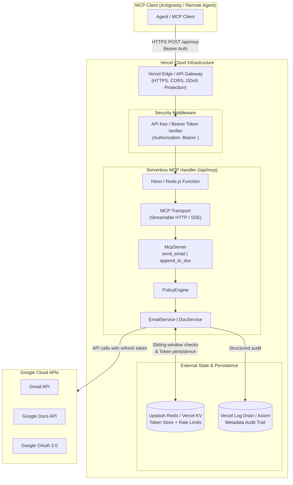
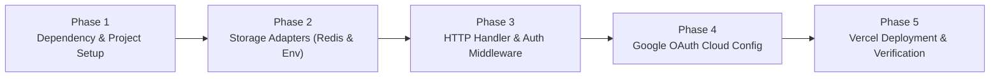

# Deployment Plan: Deploying gmail-docs-mcp on Vercel

> Comprehensive architecture migration and deployment roadmap for transitioning the **Gmail + Google Docs MCP Server** from a local stdio process to a cloud-native, serverless deployment on **Vercel**.

**Status:** Proposed  |  **Target Platform:** Vercel (Serverless / Edge)  |  **Transport:** Streamable HTTP / Server-Sent Events (SSE)  |  **Runtime:** Node.js 20+

---

## 1. Executive Summary

The current implementation of `gmail-docs-mcp` is designed as a **local stdio process**:
- Transport is standard input/output (`StdioServerTransport`).
- State is local and file-based (`token.json`, `ledger.json`, `audit.jsonl`).
- Authentication happens via a local loopback server (`http://127.0.0.1:<port>`).
- Security relies on OS-level process isolation and local client approval.

**Vercel is an ephemeral, serverless execution platform:**
- Incoming requests arrive over HTTP (public internet).
- Instances scale to zero and can terminate at any moment.
- The filesystem is read-only (except `/tmp`, which is non-shared and wiped across invocations).
- Long-lived connections are bounded by function execution timeouts (10s on Hobby, up to 300s on Pro).

This deployment plan outlines the architectural adaptations, state externalization, security hardening, and deployment steps required to run this MCP server reliably and securely on Vercel.

---

## 2. Architecture Comparison: Local Stdio vs. Vercel Serverless

| Dimension | Local Stdio (Current) | Vercel Serverless (Target) |
| :--- | :--- | :--- |
| **Transport** | `StdioServerTransport` (stdin/stdout) | `SSEServerTransport` or Streamable HTTP / JSON-RPC over POST (`/api/mcp`) |
| **State & Ledger** | File-locked JSON (`ledger.json`) in `%APPDATA%` | External distributed store: **Upstash Redis** or **Vercel KV** |
| **Token Storage** | File (`token.json`) written via `fs` | Encrypted **Vercel Environment Variables** (single-tenant) or **Upstash Redis** |
| **OAuth Flow** | Local loopback server (`127.0.0.1:0`) | Pre-authorized refresh token in Env, or hosted web callback (`/api/auth/callback`) |
| **Access Control** | OS user session & Antigravity approval | **Bearer Token / API Key** header (`Authorization: Bearer <secret>`) |
| **Audit Log** | Append-only file (`audit.jsonl`) | Structured `console.error` (Vercel Log Drains / Axiom) |
| **Execution Model**| Persistent single process | Ephemeral serverless lambdas (`@vercel/node` or Hono) |

---

## 3. High-Level Target Architecture on Vercel



---

## 4. Key Architectural Adaptations

### 4.1 Transport: HTTP / SSE Adapter
In `@modelcontextprotocol/sdk`, serverless deployments interact via HTTP:
1. **Endpoint `GET /api/mcp`**: Establishes Server-Sent Events (SSE) stream or health/status check.
2. **Endpoint `POST /api/mcp`**: Accepts incoming JSON-RPC tool calls (`tools/call`, `tools/list`).

> [!TIP]
> **Minimalist Framework Choice:**
> Use **Hono** on `@vercel/node`. Hono is ultra-lightweight (<15KB), natively handles Web Standards (Request/Response), supports streaming/SSE, and avoids the heavy overhead and build complexity of full Next.js.

### 4.2 State & Storage: Upstash Redis (Vercel Integration)
Since the Vercel filesystem is ephemeral, the local `FileTokenStore` and file-locked `Ledger` must be backed by a remote store:
- **Rate Limiting (`Ledger`)**: Backed by **Upstash Redis** sliding-window sorted sets (`ZADD`, `ZREMRANGEBYSCORE`, `ZCARD`).
- **Token Store (`TokenStore`)**:
  - **Approach A (Recommended for Personal/Single-Tenant Use):** Pre-seed `GDM_GOOGLE_REFRESH_TOKEN` as an encrypted Vercel environment variable.
  - **Approach B (Multi-session/Dynamic Rotation):** Store refreshed tokens in Upstash Redis under a secure key (`gdm:tokens:<tenant>`).

### 4.3 Public Endpoint Security
Because the MCP server is deployed to a public URL (`https://your-server.vercel.app`), it **must not be open to the internet**:
- Every request must provide a pre-shared bearer secret:
  ```http
  Authorization: Bearer <GDM_SERVER_API_KEY>
  ```
- Requests failing authentication receive `401 Unauthorized` before any MCP parsing or Google API execution occurs.

---

## 5. Phased Implementation Roadmap



### Phase 1: Project Preparation
1. Add serverless & HTTP dependencies:
   ```bash
   npm install hono @modelcontextprotocol/sdk @upstash/redis
   npm install -D @types/node
   ```
2. Create `vercel.json` configuring builds and serverless routes:
   ```json
   {
     "version": 2,
     "buildCommand": "npm run build",
     "outputDirectory": "dist",
     "rewrites": [
       { "source": "/api/(.*)", "destination": "/api/$1" }
     ]
   }
   ```

### Phase 2: State & Storage Abstractions
1. **`EnvTokenStore` (`src/auth/EnvTokenStore.ts`)**:
   Reads `GDM_GOOGLE_REFRESH_TOKEN` directly from `process.env`. If Google rotates the refresh token, optionally updates the Upstash Redis store.
2. **`RedisLedger` (`src/state/RedisLedger.ts`)**:
   Replaces `Ledger.ts` file locks with atomic Redis commands:
   ```ts
   // Sliding window: count actions in the last 60 seconds
   await redis.zremrangebyscore(key, 0, now - 60000);
   const count = await redis.zcard(key);
   if (count >= maxPerMinute) throw new DomainError('RATE_LIMITED_LOCAL', ...);
   await redis.zadd(key, { score: now, member: `${now}-${Math.random()}` });
   ```
3. **`RemoteAuditLog` (`src/state/AuditLog.ts`)**:
   Output structured JSON to `console.error` for Vercel's logging engine and log drains (Axiom/Datadog) to capture.

### Phase 3: Serverless HTTP Entrypoint (`api/index.ts`)
1. Create a Hono application mounted at `/api`:
   ```ts
   import { Hono } from 'hono';
   import { bearerAuth } from 'hono/bearer-auth';
   import { createServer } from '../src/server.js';

   const app = new Hono();

   // Security guard: require API Key
   app.use('/api/*', bearerAuth({ token: process.env.GDM_SERVER_API_KEY! }));

   // Health check
   app.get('/api/health', (c) => c.json({ status: 'ok', server: 'gmail-docs-mcp' }));

   // MCP Endpoint (SSE & POST)
   app.all('/api/mcp', async (c) => {
     // Route incoming HTTP request to MCP Server
   });

   export default app;
   ```

### Phase 4: Google Cloud Console Configuration
1. Open the [Google Cloud Console](https://console.cloud.google.com/).
2. Navigate to **APIs & Services > Credentials**.
3. Under your OAuth 2.0 Client ID:
   - If using a web OAuth flow, add `https://<your-project>.vercel.app/api/auth/callback` to **Authorized redirect URIs**.
   - If using pre-seeded refresh tokens (recommended), the existing Desktop client credentials can be reused directly.
4. Ensure **Gmail API** and **Google Docs API** are enabled in the project.

### Phase 5: Vercel Configuration & Deployment
1. Set up the project on Vercel:
   ```bash
   vercel link
   ```
2. Configure environment variables in Vercel:
   ```bash
   vercel env add GDM_GOOGLE_CLIENT_ID
   vercel env add GDM_GOOGLE_CLIENT_SECRET
   vercel env add GDM_GOOGLE_REFRESH_TOKEN
   vercel env add GDM_ACCOUNT_EMAIL
   vercel env add GDM_SERVER_API_KEY
   vercel env add UPSTASH_REDIS_REST_URL
   vercel env add UPSTASH_REDIS_REST_TOKEN
   vercel env add GDM_ALLOWED_RECIPIENTS
   vercel env add GDM_ALLOW_LIVE_SEND
   vercel env add GDM_DEFAULT_DRY_RUN
   ```
3. Deploy to production:
   ```bash
   vercel --prod
   ```

---

## 6. Client Configuration (Connecting to Vercel MCP Server)

Once deployed to Vercel, MCP clients (such as Antigravity, Claude Desktop, Cursor) connect over **SSE / HTTP** instead of `stdio`.

### Antigravity / Client Configuration (`mcpServers`)
```json
{
  "mcpServers": {
    "gmail-docs-vercel": {
      "url": "https://your-mcp-server.vercel.app/api/mcp",
      "headers": {
        "Authorization": "Bearer <YOUR_GDM_SERVER_API_KEY>"
      }
    }
  }
}
```

---

## 7. Risks, Pitfalls & Mitigations

| Risk | Impact | Mitigation |
| :--- | :--- | :--- |
| **Serverless Execution Timeout** | Long Google API calls or slow networks might get cut off | Set `maxDuration: 60` in `vercel.json`; Google API timeouts are capped at 20s. |
| **Connection Disconnects on Hobby Tier** | SSE streams cannot stay open indefinitely on serverless lambdas | Use request-response Streamable HTTP (`json-response` mode) or reconnect SSE on demand. |
| **Leaked Public URL** | Malicious users could attempt sending emails or tampering with Docs | Strict Bearer Auth middleware on every route; requests without the valid API key are dropped immediately. |
| **State Desynchronization across Lambdas** | Rate limits bypassed due to isolated local memory | Enforce all sliding-window checks through Upstash Redis atomic ZSET transactions. |
| **Token Expiration in "Testing" Consent Mode** | Refresh tokens issued in "Testing" OAuth status expire in 7 days | Set Google OAuth Consent Screen publishing status to **In Production** (or Internal if using Google Workspace). |

---

## 8. Verification & Acceptance Checklist

- [ ] Project builds with TypeScript cleanly (`npm run build`).
- [ ] Vercel deployment completes successfully via `vercel --prod`.
- [ ] `/api/health` returns HTTP 200 with status payload.
- [ ] Requests to `/api/mcp` without valid `Authorization: Bearer <token>` return HTTP 401.
- [ ] MCP Client discovers both tools (`send_email`, `append_to_doc`) over HTTP.
- [ ] `append_to_doc` executes with `dry_run: true` against a real Google Doc URL via Vercel.
- [ ] `send_email` executes with `dry_run: true` and validates recipient allowlist via Vercel.
- [ ] Upstash Redis records rate limit timestamps correctly across multiple requests.
- [ ] No tokens, credentials, or email/doc content appear in Vercel function runtime logs.
