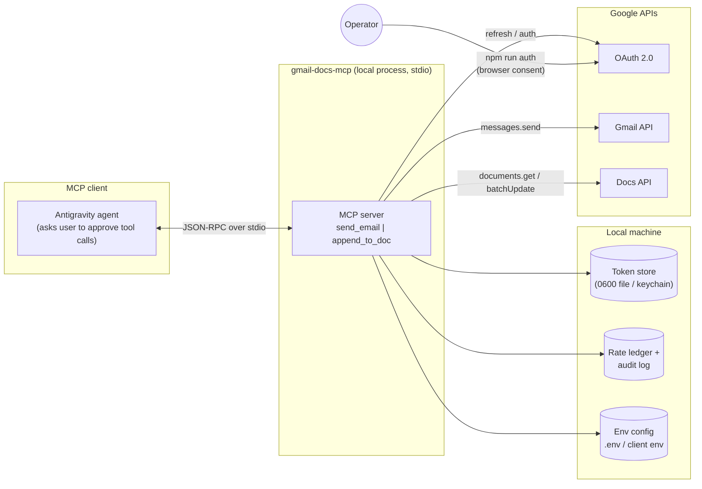
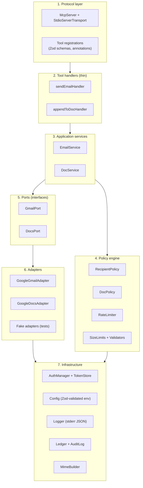
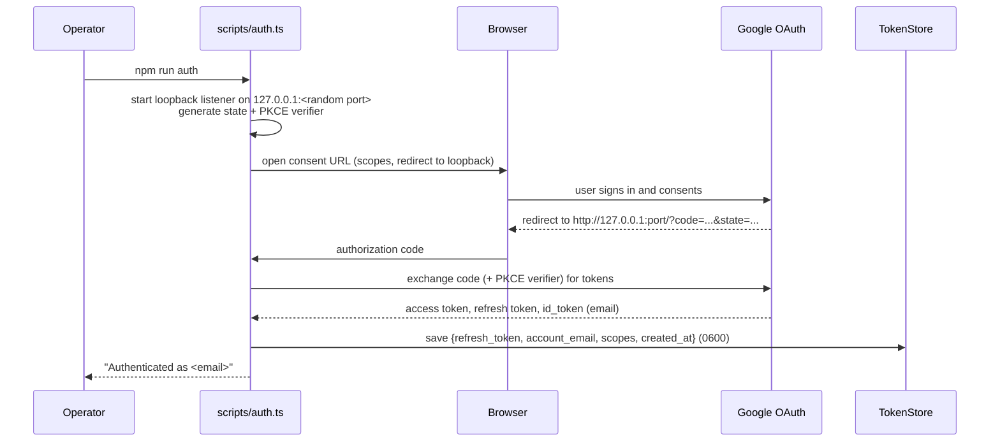
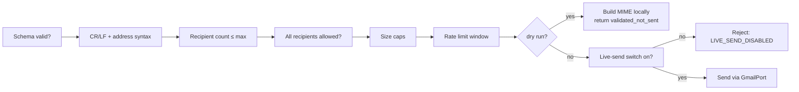
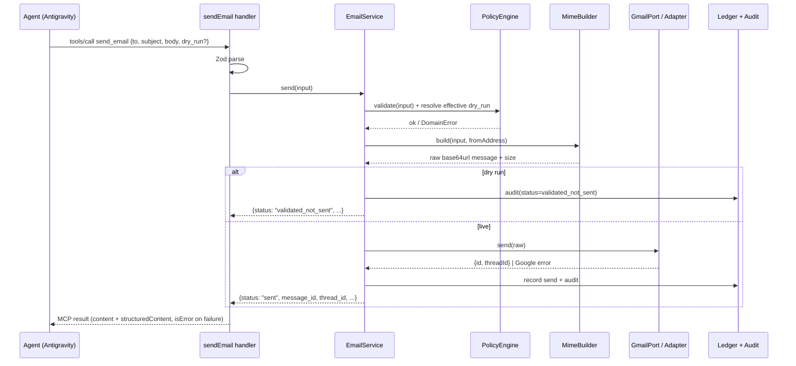
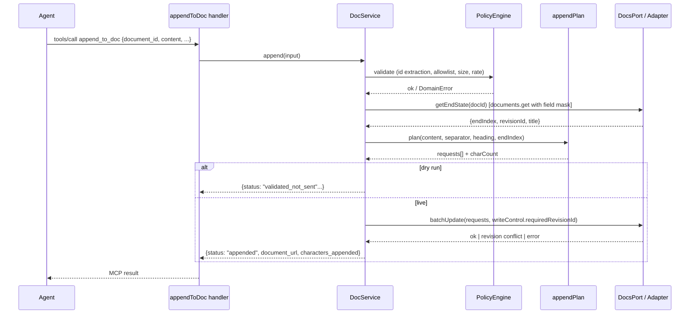
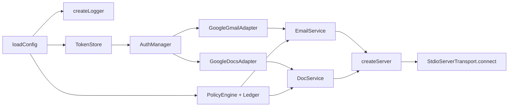

# Architecture: gmail-docs-mcp

> Companion to `mcp-server-problem-statement.md`. Defines *how* the MCP server is built: layers, modules, request flows, authentication, safety policy, state, errors, testing, and Antigravity integration.

**Status:** Draft v1  |  **Transport:** stdio  |  **Runtime:** Node.js 20+ / TypeScript (strict)  |  **Tools:** `send_email`, `append_to_doc`

---

## 1. Requirements Recap

| # | Requirement (from problem statement) | Architectural consequence |
|---|---|---|
| R1 | Tool 1: send email via Gmail | `EmailService` + Gmail adapter + MIME builder |
| R2 | Tool 2: append content to an existing Google Doc | `DocService` + Docs adapter + end-of-document insertion logic |
| R3 | Credentials stay inside the server | Dedicated `auth` module; token store on disk; nothing secret in tool args, logs, or results |
| R4 | Least-privilege scopes | Minimal scope set, defined in one place (§6.2) |
| R5 | Safety guardrails for a side-effecting tool | Server-side **policy engine** (allowlists, caps, rate limits, dry-run) that cannot be bypassed by the client |
| R6 | Structured results and errors | One error taxonomy and one result envelope |
| R7 | Run and register inside Antigravity | stdio MCP server, `npm run auth` out-of-band, config via env vars |
| R8 | Testable without Google | Ports-and-adapters design; Google clients behind interfaces |

---

## 2. Architectural Principles

1. **Thin protocol layer, fat services.** MCP handlers only parse input, call a service, and format output. All logic lives in testable services.
2. **Ports and adapters.** Services depend on `GmailPort` and `DocsPort` interfaces. Real adapters wrap Google APIs; tests use fakes.
3. **Policy before side effects.** Every call passes through the policy engine *before* any network call. Policy is configured by the operator (env/config), never by the agent.
4. **Fail closed.** Missing config, invalid policy, or unreadable ledger blocks sends rather than allowing them.
5. **No secrets or content in logs.** Logs carry metadata only (tool, status, counts, IDs, durations).
6. **stdout belongs to MCP.** All logging goes to stderr; nothing else writes to stdout.
7. **Non-idempotent by honesty.** Sends and appends are declared non-idempotent; retries are restricted accordingly.
8. **One place for each concern.** Scopes, limits, error codes, and the word "send" each have a single definition.

---

## 3. System Context



**Trust boundaries**
- **Agent ↔ server:** the agent is *untrusted input* (it may relay prompt-injected text). The server validates everything and enforces policy independently.
- **Server ↔ Google:** authenticated with the operator's OAuth tokens; scopes limit blast radius.
- **Server ↔ disk:** token and ledger files are the only persistent secrets/state.

---

## 4. Layered Design



**Dependency rule:** arrows point downward only. Services never import Google libraries; adapters never import MCP types.

---

## 5. Module Layout

```
gmail-docs-mcp/
├── README.md
├── .env.example
├── .gitignore                    # .env, tokens, ledger, dist, coverage
├── package.json
├── tsconfig.json
├── scripts/
│   └── auth.ts                   # npm run auth (OAuth consent, writes token store)
├── src/
│   ├── index.ts                  # bootstrap: load config, build container, start stdio server
│   ├── server.ts                 # createServer(deps): registers tools
│   ├── tools/
│   │   ├── sendEmail.ts          # schema + handler
│   │   ├── appendToDoc.ts        # schema + handler
│   │   └── result.ts             # success/error envelope helpers
│   ├── services/
│   │   ├── EmailService.ts
│   │   └── DocService.ts
│   ├── policy/
│   │   ├── RecipientPolicy.ts
│   │   ├── DocPolicy.ts
│   │   ├── RateLimiter.ts
│   │   ├── validators.ts         # email syntax, CR/LF guard, size limits, doc-id extraction
│   │   └── index.ts              # PolicyEngine facade
│   ├── ports/
│   │   ├── GmailPort.ts
│   │   └── DocsPort.ts
│   ├── adapters/
│   │   ├── google/
│   │   │   ├── GoogleGmailAdapter.ts
│   │   │   ├── GoogleDocsAdapter.ts
│   │   │   └── errorMap.ts       # Google error → domain error
│   │   └── fake/
│   │       ├── FakeGmail.ts
│   │       └── FakeDocs.ts
│   ├── mime/
│   │   └── buildMessage.ts       # MIME construction + base64url
│   ├── docs/
│   │   ├── appendPlan.ts         # computes batchUpdate requests for an append
│   │   └── formatters/
│   │       ├── plain.ts          # v1
│   │       └── markdownBasic.ts  # v1.1 (extension point)
│   ├── auth/
│   │   ├── AuthManager.ts        # loads tokens, refreshes, exposes OAuth2 client
│   │   ├── TokenStore.ts         # file store (0600) behind an interface
│   │   └── loopbackFlow.ts       # used only by scripts/auth.ts
│   ├── state/
│   │   ├── Ledger.ts             # send/append counters (sliding window)
│   │   └── AuditLog.ts           # JSONL, metadata only
│   ├── config/
│   │   └── config.ts             # env → typed, validated Config
│   ├── errors.ts                 # error codes + DomainError
│   └── logger.ts                 # stderr JSON logger
└── tests/
    ├── unit/
    ├── contract/                 # MCP in-memory client ↔ server
    ├── adapters/                 # HTTP-mocked Google calls
    └── fixtures/
```

**Suggested libraries:** `@modelcontextprotocol/sdk`, `zod`, `googleapis` (or `@googleapis/gmail` + `@googleapis/docs`), `google-auth-library`, `nodemailer` (MailComposer only, for MIME), `pino` (to stderr), `proper-lockfile` (ledger locking), `vitest`, `msw` or `nock` (HTTP mocks).

---

## 6. Authentication Architecture

### 6.1 Flow



At **runtime** the server never opens a browser. `AuthManager` loads the stored refresh token, builds an `OAuth2Client`, and lets `google-auth-library` refresh access tokens automatically; a `tokens` event handler persists any rotated refresh token.

### 6.2 Scopes (single definition in `config.ts`)

| Scope | Why |
|---|---|
| `https://www.googleapis.com/auth/gmail.send` | Send mail only; no mailbox read access |
| `https://www.googleapis.com/auth/documents` | Read the end index and append to Docs |
| `openid` + `email` | Learn the authenticated account's own address at auth time |

> **Deviation from the problem statement (§6):** the problem statement lists two scopes. The `gmail.send` scope does not allow reading the profile to discover the sender's address, and the default recipient allowlist depends on knowing it. `openid email` are non-sensitive identity scopes used once during `npm run auth`; the address is stored in the token file. Alternative if you prefer to avoid them: require `OWN_ADDRESS` in config.

Evaluate `drive.file` in place of `documents` as a spike; it only works if the target Docs were created or opened by this OAuth client, which likely excludes arbitrary existing Docs. Record the outcome in an ADR.

### 6.3 Token store

- `TokenStore` interface: `load()`, `save()`, `clear()`. Default implementation writes JSON to a per-user config directory (e.g., `%APPDATA%\gmail-docs-mcp\` on Windows, `~/.config/gmail-docs-mcp/` elsewhere) with owner-only permissions where the OS supports it.
- Optional OS-keychain implementation behind the same interface (evaluate a maintained keyring library; not required for v1).
- Never stored in the repo; `.gitignore` and a startup check enforce that the token path is outside the project directory unless explicitly overridden.

### 6.4 Auth failure handling

| Situation | Behavior |
|---|---|
| No token file | Tools return `AUTH_REQUIRED` ("Run `npm run auth`") immediately; no browser launch |
| `invalid_grant` (revoked/expired refresh token) | Clear cached client, return `AUTH_REQUIRED`; do not retry |
| Insufficient scopes | Return `AUTH_REQUIRED` with message to re-run auth (scopes changed) |
| Token file corrupt | `AUTH_REQUIRED`; do not overwrite automatically |

> **Risk:** apps whose OAuth consent screen is in "Testing" status may get refresh tokens that expire after a short period. Document the consent-screen configuration needed for long-running personal use, and verify against Google's current documentation.

---

## 7. Policy Engine

The policy engine is a pure, synchronous-where-possible module invoked by services before any Google call. Operators configure it via environment variables; the agent cannot change it.

### 7.1 Configuration (all validated at startup with Zod; invalid config → process exits non-zero)

| Variable | Default | Purpose |
|---|---|---|
| `GDM_ALLOWED_RECIPIENTS` | *(empty = own address only)* | Comma-separated exact addresses and `@domain` entries |
| `GDM_MAX_RECIPIENTS` | `5` | Cap on to+cc+bcc |
| `GDM_MAX_SENDS_PER_MINUTE` | `5` | Sliding-window limit |
| `GDM_MAX_SENDS_PER_DAY` | `50` | Sliding-window limit |
| `GDM_DEFAULT_DRY_RUN` | `true` | Dry-run unless the call explicitly sets `dry_run: false` **and** `GDM_ALLOW_LIVE_SEND=true` |
| `GDM_ALLOW_LIVE_SEND` | `false` | Master switch; when false, `send_email` can only dry-run |
| `GDM_ALLOWED_DOC_IDS` | *(empty = any accessible doc)* | Optional Doc allowlist |
| `GDM_MAX_APPEND_PER_MINUTE` | `10` | Append rate limit |
| `GDM_MAX_SUBJECT_CHARS` / `GDM_MAX_BODY_CHARS` / `GDM_MAX_APPEND_CHARS` | `200` / `50000` / `100000` | Size caps |
| `GDM_STATE_DIR` | per-user config dir | Token store, ledger, audit log location |
| `GDM_LOG_LEVEL` | `info` | Logger verbosity |

### 7.2 Check order for `send_email`



The **first failing check** returns its specific error code. Rate-limit counters are incremented only after a successful live send (and a send-attempt counter guards against hammering on repeated Google failures).

### 7.3 Check order for `append_to_doc`

Schema → extract/validate Doc ID → Doc allowlist → size cap → append rate limit → (dry run: `documents.get` only, to verify access) → live append.

### 7.4 Ledger

- `Ledger` stores timestamps of recent sends/appends in a small JSON file in `GDM_STATE_DIR`, written atomically (write temp file, rename) under `proper-lockfile` so **multiple server processes** (e.g., several Antigravity sessions) share limits safely.
- If the ledger cannot be read or locked, sends **fail closed** (`STATE_UNAVAILABLE`).
- Old entries are pruned on each read.

---

## 8. Tool Flow: `send_email`



### 8.1 MIME construction (`mime/buildMessage.ts`)

- Built with a MIME library (MailComposer), **never** by string concatenation.
- Headers: `From` (authenticated account, not caller-controlled), `To`/`Cc`/`Bcc`, `Subject` (RFC 2047 encoded when non-ASCII), `Reply-To` (optional), `MIME-Version`, `Content-Type`.
- `body_format: text` → `text/plain; charset=UTF-8`. `body_format: html` → `multipart/alternative` with an auto-generated plain-text fallback.
- Output encoded base64url for the Gmail `raw` field; the total encoded size is checked against a conservative cap (well under Gmail's message limit) before sending.
- Bcc is included in the raw message for Gmail to deliver but is never echoed in tool output or logs.

### 8.2 Result shape

Success and dry-run shapes follow the problem statement (§5.1). Recipient details in results are **counts only**.

---

## 9. Tool Flow: `append_to_doc`



### 9.1 Why `documents.get` first

Formatting requests (heading style, separators, later markdown styling) need **absolute index ranges**. The adapter fetches only `revisionId`, `title`, and the final body element's `endIndex` using a field mask (small, fast, read-only). The insertion point is `endIndex - 1` (just before the document's trailing newline). An empty doc has `endIndex = 2`, so insertion happens at index 1 with no special-casing.

### 9.2 Append plan (`docs/appendPlan.ts`)

Pure function: `(content, options, endIndex) → { requests[], insertedLength }`.

1. Build one text block: `[separator][heading line?][content]` with a trailing newline policy documented in tests.
2. Request 1: `insertText` at `endIndex - 1` with the block.
3. Request 2 (if heading): `updateParagraphStyle` → `HEADING_2` over the heading's range.
4. Request 3 (if `horizontal_rule`): `updateParagraphStyle` with a bottom border on the separator paragraph; **fallback** to a text line of rule characters if the spike shows the border approach is unreliable.
5. v1.1: `markdownBasic` formatter adds `updateParagraphStyle` / `updateTextStyle` / bullet requests for the supported Markdown subset; unsupported syntax is left as plain text, never dropped.

**Index arithmetic uses UTF-16 code units** (Docs API indices are UTF-16-based). Emoji and other astral characters count as 2; tests must cover this explicitly (`"₹5,000 ★ 😀"`, Devanagari text).

### 9.3 Concurrency

`batchUpdate` is sent with `writeControl.requiredRevisionId` from the `get` call. If someone edits the Doc between `get` and `batchUpdate`, Google rejects the write; the service re-fetches and **retries once** (this is safe: the first attempt provably did not apply). A second conflict returns `DOC_CONFLICT` (retryable: true).

### 9.4 Result shape

As in the problem statement (§5.2): `status`, `document_id`, `document_url` (constructed from the ID), `characters_appended`, `dry_run`. Document **content is never returned**.

---

## 10. Error Model

### 10.1 Taxonomy

```ts
type ErrorCode =
  // validation / policy (client error, not retryable)
  | 'INVALID_INPUT' | 'INVALID_RECIPIENT' | 'RECIPIENT_NOT_ALLOWED' | 'TOO_MANY_RECIPIENTS'
  | 'INVALID_SUBJECT' | 'BODY_TOO_LARGE' | 'CONTENT_TOO_LARGE'
  | 'INVALID_DOCUMENT_ID' | 'DOCUMENT_NOT_ALLOWED' | 'LIVE_SEND_DISABLED'
  | 'RATE_LIMITED_LOCAL'
  // auth / permissions
  | 'AUTH_REQUIRED' | 'PERMISSION_DENIED'
  // remote
  | 'DOCUMENT_NOT_FOUND' | 'QUOTA_EXCEEDED' | 'DOC_CONFLICT'
  | 'GMAIL_API_ERROR' | 'DOCS_API_ERROR' | 'NETWORK_ERROR' | 'TIMEOUT'
  // internal
  | 'STATE_UNAVAILABLE' | 'INTERNAL_ERROR';

interface DomainError { code: ErrorCode; message: string; retryable: boolean; hint?: string }
```

### 9.2 Mapping (`adapters/google/errorMap.ts`)

| Google signal | Domain error | Retryable |
|---|---|---|
| 401, `invalid_grant` | `AUTH_REQUIRED` | No |
| 403 insufficient scope / permission | `PERMISSION_DENIED` (or `AUTH_REQUIRED` if scope-related) | No |
| 404 on document | `DOCUMENT_NOT_FOUND` | No |
| 409/400 revision mismatch on `batchUpdate` | `DOC_CONFLICT` | Yes (service retries once) |
| 429 | `QUOTA_EXCEEDED` | Yes, with `retry-after` hint |
| 5xx | `GMAIL_API_ERROR` / `DOCS_API_ERROR` | **See retry policy** |
| Connection refused / DNS before request sent | `NETWORK_ERROR` | Yes (safe) |
| Timeout after request sent | `TIMEOUT` | **No**, outcome unknown (see below) |

### 10.3 Retry policy (non-idempotent operations)

- **Safe to retry automatically (max 3, exponential backoff + jitter):** read-only calls (`documents.get`), and failures proven to occur *before* the request reached Google.
- **Never auto-retried:** a `messages.send` or `batchUpdate` that timed out or returned 5xx after being sent, since the effect may have happened. The error says "outcome unknown; check Gmail Sent / the Doc before retrying", and the audit log records `outcome: unknown`.
- Callers (the agent) decide whether to retry; the tool descriptions warn that sends and appends are not idempotent.

### 10.4 MCP error representation

Tool failures return `isError: true` with a JSON text block `{ "error": { code, message, retryable, hint } }` (and `structuredContent` when output schemas are used). Protocol-level failures (unknown tool, malformed request) are left to the SDK.

---

## 11. Observability and Audit

- **Logger:** `pino` configured with destination = stderr (fd 2), JSON lines, level from config. A unit/contract test asserts that stdout contains only MCP protocol frames.
- **Log fields (allowlist):** `ts`, `level`, `tool`, `status`, `error_code`, `duration_ms`, `recipient_count`, `doc_id`, `chars`, `dry_run`, `message_id`.
- **Never logged:** tokens, client secret, subject, body, appended content, recipient addresses (domain-only counts if needed for debugging).
- **Audit log:** `GDM_STATE_DIR/audit.jsonl`, append-only, same field allowlist plus `outcome` (`sent`, `validated_not_sent`, `rejected`, `unknown`). Rotated by size.
- **Redaction test:** a test seeds canary strings into subject/body/content and asserts they appear in **no** log line, audit line, or tool result (other than where explicitly echoed, which is nowhere).

---

## 12. Tool Registration and Annotations

```ts
server.registerTool('send_email', {
  title: 'Send email (Gmail)',
  description:
    'Sends a REAL email from the authenticated Gmail account. Recipients must be on the operator allowlist. ' +
    'Not idempotent: calling twice sends twice. Use dry_run: true to validate without sending.',
  inputSchema: SendEmailInput,          // Zod
  annotations: { readOnlyHint: false, destructiveHint: true, idempotentHint: false, openWorldHint: true },
}, sendEmailHandler);

server.registerTool('append_to_doc', {
  title: 'Append to Google Doc',
  description:
    'Appends text to the END of an existing Google Doc. Never edits or deletes existing content. ' +
    'Not idempotent: calling twice appends twice. Use dry_run: true to validate access first.',
  inputSchema: AppendToDocInput,
  annotations: { readOnlyHint: false, destructiveHint: false, idempotentHint: false, openWorldHint: true },
}, appendToDocHandler);
```

Tool and parameter descriptions are written for an LLM reader: they state side effects, limits, and what `dry_run` does, so the agent picks sensible arguments and Antigravity can show a meaningful approval prompt. (Registration API names vary slightly across SDK versions; follow the installed SDK's documentation.)

---

## 13. Dependency Injection and Bootstrapping



`index.ts` wires the object graph once ("composition root"). Tests build the same graph with `FakeGmail`/`FakeDocs` and an in-memory ledger. **Startup sequence:** load config (fail fast) → create logger → load auth (missing token is allowed; tools will report `AUTH_REQUIRED`) → build services → register tools → connect transport. The server never blocks on interactive input.

---

## 14. Antigravity Integration

### 14.1 Registration (example, verify against Antigravity's current MCP configuration docs)

```json
{
  "mcpServers": {
    "gmail-docs": {
      "command": "node",
      "args": ["D:/VibeCode/gmail-docs-mcp/dist/index.js"],
      "env": {
        "GDM_GOOGLE_CLIENT_ID": "<client id>",
        "GDM_GOOGLE_CLIENT_SECRET": "<client secret>",
        "GDM_ALLOWED_RECIPIENTS": "",
        "GDM_DEFAULT_DRY_RUN": "true",
        "GDM_ALLOW_LIVE_SEND": "false"
      }
    }
  }
}
```

The client ID/secret live in the MCP client's `env` or a local `.env` read by `npm run auth`; they are **not** committed. Start with live send **disabled**, run the smoke tests in dry-run, then enable `GDM_ALLOW_LIVE_SEND=true` deliberately.

### 14.2 Operating model

1. Operator creates the Google Cloud project, enables Gmail API and Docs API, configures the consent screen, creates a Desktop OAuth client.
2. Operator runs `npm run auth` once (browser consent).
3. Antigravity launches `node dist/index.js` over stdio on demand.
4. Antigravity should prompt for human approval on `send_email` (destructive hint); the server's own policy still applies if approval is auto-granted.

### 14.3 Smoke-test prompts

1. "Call `append_to_doc` with `dry_run` true on `<doc url>` and tell me the result."
2. "Now append 'MCP test entry' for real."
3. "Call `send_email` with `dry_run` true to my own address; subject 'MCP test'."
4. "Now send it for real."
5. Negative: "Send an email to someone@other-domain.com" → must return `RECIPIENT_NOT_ALLOWED`.

---

## 15. Security and Threat Model

| Threat | Vector | Mitigation |
|---|---|---|
| **Prompt injection → data exfiltration by email** | Untrusted text instructs the agent to email secrets to an attacker | Recipient allowlist (default: own address), live-send master switch, rate limits, human approval in the client, no read tools exposed |
| **Spam/abuse** | Agent loop sends repeatedly | Per-minute/day caps in a cross-process ledger; recipient cap |
| **Header injection** | CR/LF in subject or address | Reject control characters; MIME library builds headers |
| **Sender spoofing** | Caller sets `From` | `From` is not an input; always the authenticated account |
| **Doc tampering** | Agent appends to an unintended Doc | Optional `GDM_ALLOWED_DOC_IDS`; append-only; no delete/replace tools |
| **Credential theft** | Tokens read from disk or logs | Owner-only token file outside the repo, no secrets in logs/results, minimal scopes |
| **Token in repo** | Accidental commit | `.gitignore`, startup check on token path, secret-scan in CI |
| **Stdout corruption** | A stray `console.log` breaks the protocol | Lint rule banning `console.*` (use logger), stdout-cleanliness test |
| **Supply chain** | Malicious dependency | Lockfile, pinned versions, audit in CI, small dependency set |
| **Race conditions** | Two processes exceed limits | File-locked ledger |
| **Duplicate effects on retry** | Timeout then retry | Non-idempotent semantics, restricted retry policy, explicit "outcome unknown" |
| **Content-derived rendering issues** | Malicious HTML in email body | `html` format is sent as-is by operator/agent intent; no remote content is fetched by the server; document in README that HTML is the caller's responsibility |

---

## 16. Testing Strategy

| Level | Scope | Approach |
|---|---|---|
| **Unit** | validators, policy checks, rate limiter, `appendPlan`, MIME builder, error mapper, config parsing | Vitest; no I/O; table-driven cases |
| **Service** | `EmailService`, `DocService` | Fake ports; assert call sequences and that policy runs before any port call |
| **Adapter** | Google adapters | HTTP-level mocks (msw/nock) asserting request shape: `messages.send` raw body, `documents.get` field mask, `batchUpdate` requests and `writeControl` |
| **Contract** | MCP surface | SDK in-memory transport/client: list tools (exactly two), call each, assert schemas, annotations, `isError` behavior |
| **Process** | stdio | Spawn the built server, speak MCP over stdio, assert stdout contains only protocol messages and logs go to stderr |
| **Security** | canaries, secrets | Canary strings never in logs/audit/results; no tokens in output; token file permissions test (POSIX) |
| **Golden** | MIME messages | Snapshot of generated MIME for ASCII, non-ASCII subject, HTML+text, Bcc |
| **Manual smoke** | Real Google, personal account | Checklist in §14.3 plus rerun after revoking access |

**Key cases (detailed IDs can be added to an `edge-case.md` for this server):**
- Subject/address with CR/LF rejected; `"₹ ★ देवनागरी 😀"` round-trips.
- Recipient not on allowlist rejected *before* any Gmail call (assert zero port calls).
- 6th send within a minute rejected; two processes share the same limits.
- `append_to_doc` with Doc URL vs ID; with allowlist miss; with empty Doc; with astral characters (UTF-16 index math); revision conflict retried once.
- Timeout after send → `TIMEOUT`, `outcome: unknown`, no automatic resend.
- Missing token → `AUTH_REQUIRED` without hanging.
- Live send blocked when `GDM_ALLOW_LIVE_SEND=false` even if `dry_run: false`.

---

## 17. Build, Packaging, and Scripts

| Script | Purpose |
|---|---|
| `npm run build` | Compile TypeScript to `dist/` |
| `npm run auth` | One-time OAuth consent; writes the token store |
| `npm run auth:status` | Prints authenticated account and scopes (no tokens) |
| `npm run auth:revoke` | Deletes the local token store (and optionally revokes at Google) |
| `npm test` | Unit, service, adapter, contract tests |
| `npm run test:process` | Stdio process test against the built server |
| `npm run lint` | ESLint with `no-console` and import-boundary rules |

CI: type-check, lint, tests, dependency audit, secret scan. Cross-platform: path handling via `path`/`os`; tested on Windows and POSIX.

---

## 18. Delivery Plan

| Milestone | Scope | Exit criteria |
|---|---|---|
| **M0 Spike** | Google Cloud setup; OAuth loopback script; `drive.file` vs `documents` check; horizontal-rule approach check; confirm Antigravity MCP registration steps | Tokens stored; one manual Doc append and one self-email sent from a throwaway script |
| **M1 Skeleton** | Config, logger, error model, MCP server with both tools returning fake results (fake ports) | Contract + stdout-cleanliness tests green; Antigravity lists both tools |
| **M2 Email** | Policy engine, ledger, MIME builder, Gmail adapter, dry-run and live paths | `send_email` dry-run and live (to self) work; policy tests green |
| **M3 Docs** | `appendPlan`, Docs adapter, revision guard, allowlist | `append_to_doc` works on empty and large Docs; UTF-16 tests green |
| **M4 Hardening** | Audit log, cross-process limits, auth failure paths, README, `.env.example`, smoke checklist | All acceptance criteria in the problem statement met |
| **M5 (optional)** | `markdownBasic` formatter; `create_doc`/`create_draft` tools if the Groww pulse will use this server | Decided after M4 |

---

## 19. Key Decisions (ADR Summary)

| # | Decision | Rationale | Alternatives |
|---|---|---|---|
| ADR-1 | TypeScript + official MCP SDK over stdio | Matches Antigravity's local-server model; strong typing; official SDK | Python SDK |
| ADR-2 | Ports-and-adapters around Google clients | Testing without network; swap implementations | Direct calls in handlers |
| ADR-3 | Server-side policy engine; default own-address allowlist | Agent input is untrusted; protects against injection-driven exfiltration | Rely on client approval only |
| ADR-4 | Live send behind a master switch, default off | Safe first run; deliberate enablement | Always live |
| ADR-5 | Fetch `endIndex` then `batchUpdate` with `requiredRevisionId` | Enables formatting ranges and detects concurrent edits | Blind `endOfSegmentLocation` insert (no styling, no conflict detection) |
| ADR-6 | No automatic retry after a sent request fails ambiguously | Avoid duplicate emails/appends | Blanket retries |
| ADR-7 | Loopback OAuth with PKCE, auth done out-of-band | No interactive blocking in tool calls; standard installed-app flow | Device flow; in-session consent |
| ADR-8 | Add `openid email` scopes | Needed to know own address for the default allowlist | Require `OWN_ADDRESS` config |
| ADR-9 | File-locked JSON ledger | Cross-process limits with minimal dependencies | SQLite (heavier), in-memory (not shared) |
| ADR-10 | Send/append are annotated non-idempotent; no idempotency keys in v1 | Honest semantics; keep v1 small | Key ledger (future) |

---

## 20. Risks and Open Items

| Risk / Open item | Mitigation / Next step |
|---|---|
| Consent screen in "Testing" status → short-lived refresh tokens | Verify current Google behavior; document production/internal configuration for long-running use |
| `drive.file` likely insufficient for arbitrary existing Docs | Spike in M0; default to `documents` |
| Horizontal-rule separator via paragraph border may render inconsistently | Spike in M0; text-rule fallback is specified |
| SDK API drift (`registerTool` signature, annotation fields) | Pin SDK version; contract tests catch drift |
| Antigravity's approval behavior for destructive tools is unverified | Test in M1; rely on server policy regardless |
| Gmail daily sending limits and Docs API quotas | Local limits set below Google's; `QUOTA_EXCEEDED` surfaced clearly |
| Serving the Groww pulse requires `create_doc` / `create_draft`, and the pulse is draft-only | Decide after M4; if used, add those tools and keep `GDM_ALLOW_LIVE_SEND=false` for the pulse |

---

## 21. Traceability to the Problem Statement

| Problem-statement item | Where addressed |
|---|---|
| `send_email` tool and schema | §8, §12 |
| `append_to_doc` tool and schema | §9, §12 |
| OAuth, least-privilege scopes, token handling | §6 |
| Recipient allowlist, caps, rate limits, dry-run, header-injection guard | §7, §15 |
| Doc allowlist, size limits | §7 |
| Structured errors, retry rules | §10 |
| No content/secrets in logs; stderr logging | §11 |
| Antigravity registration and smoke tests | §14 |
| Testability without Google | §4, §13, §16 |
| Deliverables and layout | §5, §17 |
| Acceptance criteria | §16, §18 (M4 exit) |
